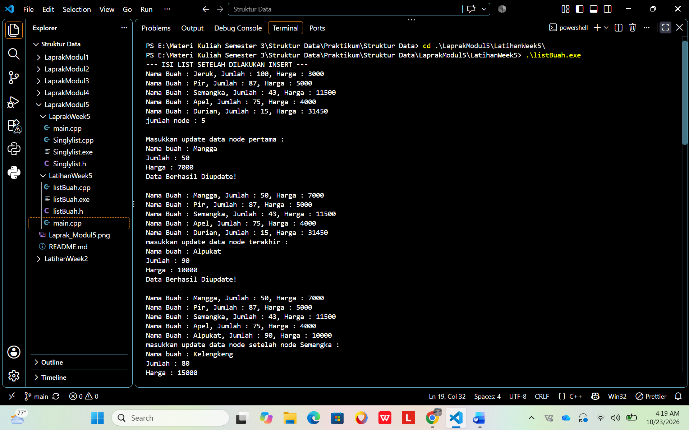
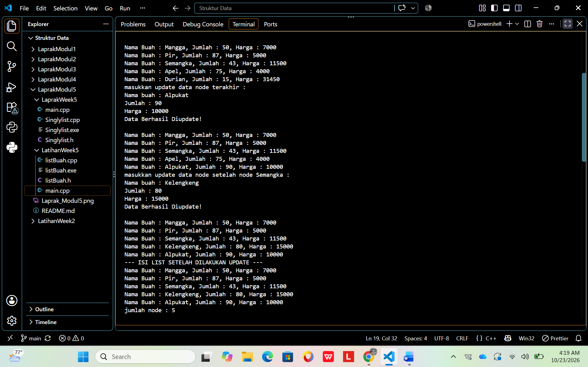
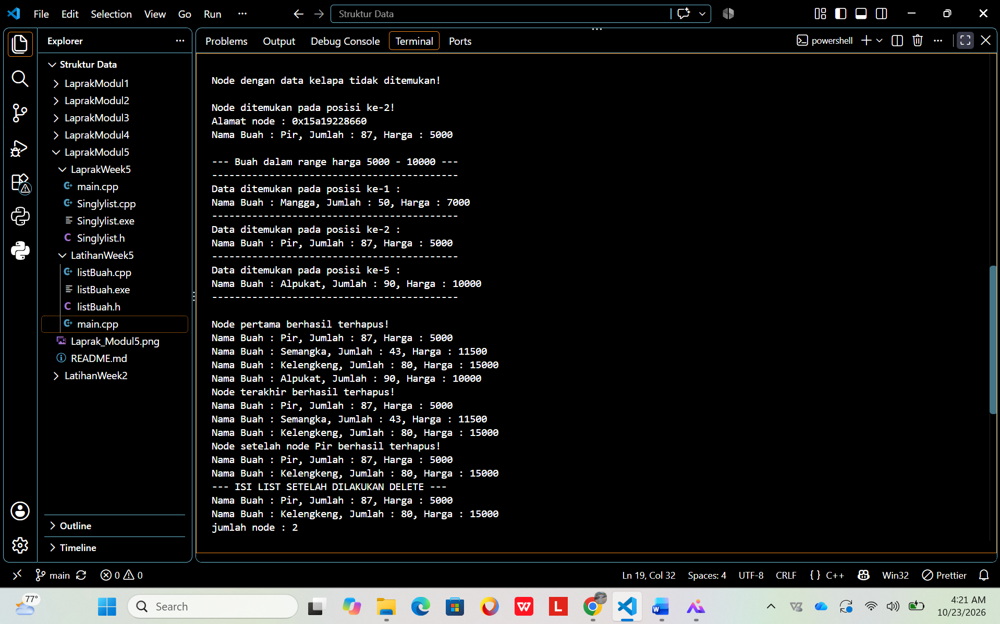
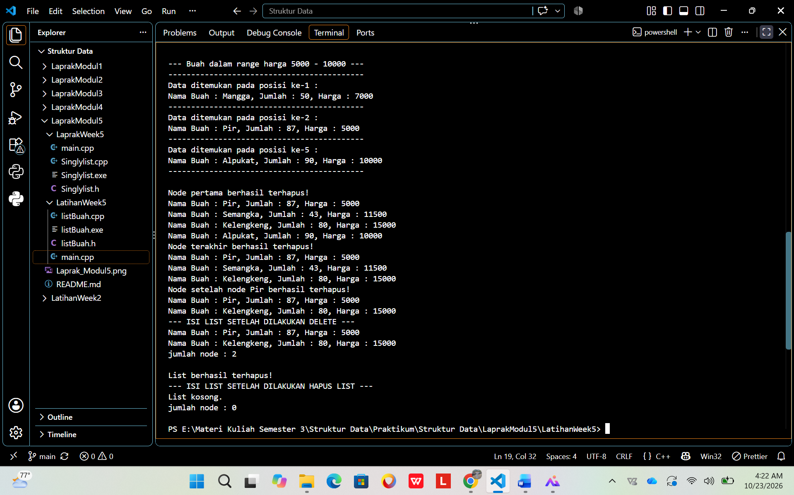
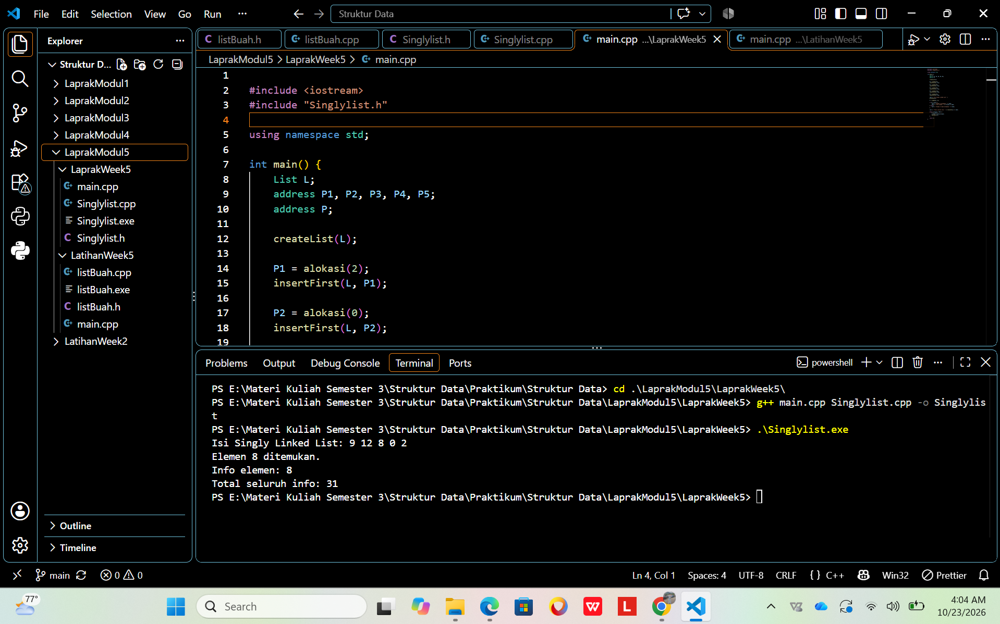

# Praktikum Struktur Data --- Modul 5: Singly Linked List (Bagian Kedua)

## Identitas

-   **Mata kuliah:** Struktur Data
-   **Materi:** Singly Linked List --- Update dan Searching
-   **Modul:** 5
-   **Nama:** Rakhmat Pratama
-   **NIM:** 109082530037
-   **Kelas:** S1IF-13-01
-   **Institusi:** Telkom University

------------------------------------------------------------------------

## Daftar Isi

-   [Pendahuluan](#pendahuluan)
-   [Tujuan Praktikum](#tujuan-praktikum)
-   [Konsep Teori](#konsep-teori)
-   [Bagian A --- Guided](#bagian-a--guided)
    -   [Deskripsi Guided](#deskripsi-guided)
    -   [File listBuah.h](#1-file-listbuahh)
    -   [File listBuah.cpp](#2-file-listbuahcpp)
    -   [File main.cpp](#3-file-maincpp)
    -   [Cara Menjalankan Guided](#cara-menjalankan-guided)
    -   [Output Guided](#output-guided)
-   [Bagian B --- Unguided/Laprak](#bagian-b--unguidedlaprak)
    -   [Deskripsi Unguided](#deskripsi-unguided)
    -   [File Singlylist.h](#1-file-singlylisth)
    -   [File Singlylist.cpp](#2-file-singlylistcpp)
    -   [File main.cpp](#3-file-maincpp-1)
    -   [Cara Menjalankan Unguided](#cara-menjalankan-unguided)
    -   [Output Unguided](#output-unguided)
-   [Kesimpulan](#kesimpulan)
-   [Daftar Pustaka](#daftar-pustaka)

------------------------------------------------------------------------

## Pendahuluan

Singly Linked List merupakan struktur data linear yang terdiri atas
node-node yang saling terhubung melalui pointer. Setiap node menyimpan
informasi dan pointer `next` yang menunjuk ke node berikutnya. Pada
singly linked list, penelusuran dilakukan dari node pertama (`first`)
menuju node berikutnya sampai pointer bernilai `Nil`/`NULL`.

Pada Modul 5, materi yang dipraktikkan adalah **update** dan
**searching** pada singly linked list. Bagian Guided menggunakan data
buah yang memiliki nama, jumlah, dan harga. Program memperlihatkan
operasi dasar list dari modul sebelumnya, kemudian menambahkan operasi
untuk memperbarui data dan mencari node. Bagian Unguided menerapkan ADT
singly linked list sederhana untuk data integer, pencarian elemen, dan
perhitungan jumlah seluruh nilai.

## Tujuan Praktikum

1.  Memahami struktur node pada singly linked list dan hubungan
    antarnode melalui pointer.
2.  Memahami fungsi `first`, `next`, dan `Nil` dalam pengelolaan list.
3.  Menerapkan operasi insert, delete, dan menghitung jumlah node.
4.  Memperbarui data pada node pertama, node terakhir, dan node setelah
    node tertentu.
5.  Mencari node berdasarkan data, alamat node, serta rentang harga.
6.  Menerapkan ADT dengan memisahkan deklarasi, implementasi, dan
    program utama dalam file berbeda.
7.  Mengelola alokasi dan dealokasi memori dinamis.

## Konsep Teori

### 1. Node dan pointer

Node adalah unit penyimpan data dalam linked list. Pada Guided, setiap
node menyimpan `nama`, `jumlah`, dan `harga` melalui struktur `buah`,
serta pointer `next`. Pada Unguided, setiap node menyimpan `info`
bertipe integer dan pointer `next`.

### 2. Pointer `first` dan `next`

`first` menunjuk ke node pertama pada list. Pointer `next` pada setiap
node menghubungkan node tersebut ke node selanjutnya. Node terakhir
memiliki `next` bernilai `Nil`, yang menandakan akhir list. Jika
`first == Nil`, list berada dalam keadaan kosong.

### 3. Alokasi dan dealokasi

`alokasi()` membuat node baru menggunakan `new`, lalu mengisi data dan
mengatur `next` menjadi `Nil`. `dealokasi()` membebaskan memori node
menggunakan `delete`. Node yang sudah tidak dipakai perlu dibebaskan
agar memori dinamis tidak tertinggal.

### 4. Operasi insert dan delete

-   `insertFirst()` menambahkan node di awal list.
-   `insertAfter()` menambahkan node setelah node yang ditunjuk oleh
    `Prev`.
-   `insertLast()` menambahkan node di akhir list.
-   `delFirst()` menghapus node pertama.
-   `delLast()` menghapus node terakhir.
-   `delAfter()` menghapus node setelah node sebelumnya yang ditentukan.
-   `deleteList()` menghapus semua node dan mengatur `first` menjadi
    `Nil`.

### 5. Update

Operasi update mengubah data yang tersimpan di node tanpa harus membuat
node baru.

-   `updateFirst()` memperbarui data pada node pertama.
-   `updateLast()` menelusuri list hingga node terakhir, lalu
    memperbarui datanya.
-   `updateAfter()` memperbarui data pada node setelah node yang
    diberikan sebagai `nodePrev`.

### 6. Searching

-   `FindNodeByData()` menelusuri list untuk menemukan nama buah yang
    sama dengan data pencarian.
-   `FindNodeByAddress()` membandingkan alamat pointer node dengan
    alamat yang dicari.
-   `FindNodeByRange()` menampilkan data buah dengan harga yang berada
    di antara batas bawah dan batas atas, termasuk kedua batas tersebut.
-   Pada Unguided, `findElm()` mengembalikan alamat node pertama yang
    memiliki nilai `info` sama dengan nilai yang dicari.
-   `totalInfo()` menelusuri node dan menjumlahkan semua nilai `info`.

### 7. ADT dan pemisahan file

File header (`.h`) berisi deklarasi struktur data dan prototype fungsi.
File implementasi (`.cpp`) berisi definisi fungsi. `main.cpp` berfungsi
sebagai program utama untuk menguji operasi ADT. Pemisahan ini membuat
kode lebih terstruktur dan memudahkan pengelolaan program.

# Bagian A --- Guided

## Deskripsi Guided

Program Guided menggunakan singly linked list untuk menyimpan data buah.
Setiap data berisi nama buah, jumlah, dan harga. Program membuat lima
node awal: Jeruk, Apel, Pir, Semangka, dan Durian. Selanjutnya program
menampilkan list, meminta pembaruan data node pertama, node terakhir,
dan node setelah node Semangka, melakukan pencarian berdasarkan
nama/alamat/rentang harga, menghapus node, kemudian menghapus seluruh
list.

## 1. File `listBuah.h`

File header mendefinisikan struktur data dan mendeklarasikan
fungsi/prosedur yang digunakan oleh program.

``` cpp
listBuah.h
//Header guard digunakan untuk mencegah file header yang sama
//di-include lebih dari sekali dalam satu program.
#ifndef LISTBUAH_H
#define LISTBUAH_H
#define Nil NULL
#include<iostream>
using namespace std;
struct buah{
string nama;
int jumlah;
float harga;
};
typedef buah dataBuah; //Memberikan nama alias databuah untuk struct buah.
typedef struct node *address; //Mendefinisikan alias address sebagai pointer ke struct node
struct node{ // node untuk isi dari linked listnya, isi setiap node adalah data & pointer next
dataBuah isidata;
address next;
};
struct linkedlist{ //ini linked list nya
address first;
};
//semua function & prosedur yang akan dipakai
//Materi modul 4
bool isEmpty(linkedlist List);
void createList(linkedlist &List);
address alokasi(string nama, int jumlah, float harga);
void dealokasi(address &node);
void printList(linkedlist List);
void insertFirst(linkedlist &List, address nodeBaru);
void insertAfter(linkedlist &List, address nodeBaru, address Prev);
void insertLast(linkedlist &List, address nodeBaru);
void delFirst(linkedlist &List);
void delLast(linkedlist &List);
void delAfter(linkedlist &List, address nodeHapus, address nodePrev);
int nbList(linkedlist List);
void deleteList(linkedlist &List);
//materi modul 5 (update)
void updateFirst(linkedlist List);
void updateLast(linkedlist List);
void updateAfter(linkedlist List, address prev);
//materi modul 5 (searching)
void FindNodeByData(linkedlist list, string data);
void FindNodeByAddress(linkedlist list, address node);
void FindNodeByRange(linkedlist list, float hargaAwal, float HargaAkhir);
#endif
```

### Penjelasan

-   `#ifndef`, `#define`, dan `#endif` merupakan header guard agar isi
    header tidak diproses berulang kali.
-   `struct buah` menyimpan atribut `nama`, `jumlah`, dan `harga`.
-   `dataBuah` merupakan alias untuk struktur `buah`.
-   `address` merupakan alias pointer ke `struct node`.
-   `struct node` berisi `isidata` dan pointer `next`.
-   `struct linkedlist` menyimpan pointer `first` sebagai penanda node
    pertama.
-   Prototype dibagi menjadi operasi dasar, update, dan searching.

## 2. File `listBuah.cpp`

File ini berisi implementasi fungsi dan prosedur yang dideklarasikan di
`listBuah.h`.

``` cpp
listBuah.cpp
#include "listBuah.h"
#include <iostream>
using namespace std;
//fungsi untuk cek apakah list kosong atau tidak
bool isEmpty(linkedlist List) {
if(List.first == Nil){
return true;
} else {
return false;
}
}
//pembuatan linked list kosong
void createList(linkedlist &List) {
List.first = Nil;
}
//pembuatan node baru dengan menerapkan manajemen memori
address alokasi(string nama, int jumlah, float harga) {
address nodeBaru = new node;
nodeBaru->isidata.nama = nama;
nodeBaru->isidata.jumlah = jumlah;
nodeBaru->isidata.harga = harga;
nodeBaru->next = Nil;
return nodeBaru;
}
//penghapusan node dengan menerapkan manajemen memori
void dealokasi(address &node) {
node->next = Nil;
delete node;
}
//prosedur-prosedur untuk insert / menambahkan node baru kedalam list
void insertFirst(linkedlist &List, address nodeBaru) {
nodeBaru->next = List.first;
List.first = nodeBaru;
}
void insertAfter(linkedlist &List, address nodeBaru, address Prev) {
if (Prev != Nil) {
nodeBaru->next = Prev->next;
Prev->next = nodeBaru;
} else {
cout << "Node sebelumnya tidak valid!" << endl;
}
}
void insertLast(linkedlist &List, address nodeBaru) {
if (isEmpty(List)) {
List.first = nodeBaru;
} else {
address nodeBantu = List.first;
while (nodeBantu->next != Nil) {
nodeBantu = nodeBantu->next;
}
nodeBantu->next = nodeBaru;
}
}
//prosedur-prosedur untuk delete / menghapus node yang ada didalam list
void delFirst(linkedlist &List){
address nodeHapus;
if (isEmpty(List) == false) {
nodeHapus = List.first;
List.first = List.first->next;
nodeHapus->next = Nil;
dealokasi(nodeHapus);
cout << "Node pertama berhasil terhapus!" << endl;
} else {
cout << "List kosong!" << endl;
}
}
void delLast(linkedlist &List){
address nodeHapus, nodePrev;
if(isEmpty(List) == false){
nodeHapus = List.first;
if(nodeHapus->next == Nil){
List.first->next = Nil;
dealokasi(nodeHapus);
} else {
while(nodeHapus->next != Nil){
nodePrev = nodeHapus;
nodeHapus = nodeHapus->next;
}
nodePrev->next = Nil;
dealokasi(nodeHapus);
}
cout << "Node terakhir berhasil terhapus!" << endl;
} else {
cout << "list kosong" << endl;
}
}
void delAfter(linkedlist &List, address nodeHapus, address nodePrev){
if(isEmpty(List) == true){
cout << "List kosong!" << endl;
} else { //jika list tidak kosong
if (nodePrev != Nil && nodePrev->next != Nil) {
nodeHapus = nodePrev->next;
nodePrev->next = nodeHapus->next;
nodeHapus->next = Nil;
dealokasi(nodeHapus);
cout << "Node setelah node " << nodePrev->isidata.nama << " berhasil terhapus!" << endl;
} else {
cout << "Node sebelumnya (prev) tidak valid!" << endl;
}
}
}
//prosedur untuk menampilkan isi list
void printList(linkedlist List) {
if (isEmpty(List)) {
cout << "List kosong." << endl;
} else {
address nodeBantu = List.first;
while (nodeBantu != Nil) {
cout << "Nama Buah : " << nodeBantu->isidata.nama << ", Jumlah : " << nodeBantu->isidata.jumlah << ", Harga : " << nodeBantu->isidata.harga << endl;
nodeBantu = nodeBantu->next;
}
}
}
//function untuk menampilkan jumlah node didalam list
int nbList(linkedlist List) {
int count = 0;
address nodeBantu = List.first;
while (nodeBantu != Nil) {
count++;
nodeBantu = nodeBantu->next;
}
return count;
}
//prosedur untuk menghapus list (menghapus semua node didalam list)
void deleteList(linkedlist &List){
address nodeBantu, nodeHapus;
nodeBantu = List.first;
while(nodeBantu != Nil){
nodeHapus = nodeBantu;
nodeBantu = nodeBantu->next;
dealokasi(nodeHapus);
}
List.first = Nil;
cout << "List berhasil terhapus!" << endl;
}
/*----- MATERI PERTEMUAN 5 - SINGLY LINKED LIST (BAGIAN KEDUA) - UPDATE -----*/
//prosedur-prosedur untuk melakukan update data node
void updateFirst(linkedlist List){
if(isEmpty(List) == true){
cout << "List kosong!" << endl;
} else {
cout << "Masukkan update data node pertama : " << endl;
cout << "Nama buah : ";
cin >> List.first->isidata.nama;
cout << "Jumlah : ";
cin >> List.first->isidata.jumlah;
cout << "Harga : ";
cin >> List.first->isidata.harga;
cout << "Data Berhasil Diupdate!" << endl;
cout << endl;
}
}
void updateLast(linkedlist List){
if (isEmpty(List) == true) {
cout << "List Kosong!" << endl;
} else {
address nodeBantu = List.first;
while (nodeBantu->next != Nil) {
nodeBantu = nodeBantu->next;
}
cout << "masukkan update data node terakhir : " << endl;
cout << "Nama buah : ";
cin >> nodeBantu->isidata.nama;
cout << "Jumlah : ";
cin >> nodeBantu->isidata.jumlah;
cout << "Harga : ";
cin >> nodeBantu->isidata.harga;
cout << "Data Berhasil Diupdate!" << endl;
cout << endl;
}
}
void updateAfter(linkedlist List, address nodePrev){
if(isEmpty(List) == true){
cout << "List kosong!" << endl;
} else {
if (nodePrev != Nil && nodePrev->next != Nil){
address nodeBantu = nodePrev->next;
cout << "masukkan update data node setelah node " << nodePrev->isidata.nama << " : " << endl;
cout << "Nama buah : ";
cin >> nodeBantu->isidata.nama;
cout << "Jumlah : ";
cin >> nodeBantu->isidata.jumlah;
cout << "Harga : ";
cin >> nodeBantu->isidata.harga;
cout << "Data Berhasil Diupdate!" << endl;
cout << endl;
} else {
cout << "Node sebelumnya (prev) tidak valid!" << endl;
}
}
}
/*----- MATERI PERTEMUAN 5 - SINGLY LINKED LIST (BAGIAN KEDUA) - SEARCHING -----*/
//prosedur-prosedur untuk searching data
//prosedur untuk mencari node berdasarkan data
void FindNodeByData(linkedlist list, string data){
if(isEmpty(list) == true){
cout << "List kosong!" << endl;
} else {
address nodeBantu = list.first;
int posisi = 0;
bool found = false;
while(nodeBantu != Nil){
posisi++;
if(nodeBantu->isidata.nama == data){
cout << "Data " << data << " ditemukan pada posisi ke-" << posisi << "!" << endl;
cout << "Nama Buah : " << nodeBantu->isidata.nama << ", Jumlah : " << nodeBantu->isidata.jumlah << ", Harga : " << nodeBantu->isidata.harga << endl;
found = true;
break;
}
nodeBantu = nodeBantu->next;
}
if(found == false){
cout << "Node dengan data " << data << " tidak ditemukan!" << endl;
}
}
cout << endl;
}
//prosedur untuk mencari node berdasarkan alamat node
void FindNodeByAddress(linkedlist list, address node) {
if(isEmpty(list) == true) {
cout << "List kosong!" << endl;
} else {
address nodeBantu = list.first;
int posisi = 0;
bool found = false;
while (nodeBantu != Nil) {
posisi++;
if(nodeBantu == node) {
cout << "Node ditemukan pada posisi ke-" << posisi << "!" << endl;
cout << "Alamat node : " << nodeBantu << endl;
cout << "Nama Buah : " << nodeBantu->isidata.nama << ", Jumlah : " << nodeBantu->isidata.jumlah << ", Harga : " << nodeBantu->isidata.harga << endl;
found = true;
break;
}
nodeBantu = nodeBantu->next;
}
if(found == false) {
cout << "Node dengan alamat " << node << " tidak ditemukan dalam list!" << endl;
}
}
cout << endl;
}
//prosedur untuk mencari node berdasarkan range data (range harga)
void FindNodeByRange(linkedlist list, float hargaAwal, float hargaAkhir) {
if(isEmpty(list) == true) {
cout << "List kosong!" << endl;
} else {
address nodeBantu = list.first;
int posisi = 0;
bool found = false;
cout << "--- Buah dalam range harga " << hargaAwal << " - " << hargaAkhir << " ---" << endl;
cout << "-------------------------------------------" << endl;
while (nodeBantu != Nil) {
posisi++;
float harga = nodeBantu->isidata.harga;
if(harga >= hargaAwal && harga <= hargaAkhir) {
cout << "Data ditemukan pada posisi ke-" << posisi << " :" << endl;
cout << "Nama Buah : " << nodeBantu->isidata.nama << ", Jumlah : " << nodeBantu->isidata.jumlah << ", Harga : " << nodeBantu->isidata.harga << endl;
cout << "-------------------------------------------" << endl;
found = true;
}
nodeBantu = nodeBantu->next;
}
if(found == false) {
cout << "Tidak ada data buah dalam range harga tersebut!" << endl;
cout << "-------------------------------------------" << endl;
}
}
cout << endl;
}
```

### Penjelasan per kelompok fungsi

**Operasi dasar** - `isEmpty()` memeriksa apakah `first` bernilai
`Nil`. - `createList()` menginisialisasi list kosong. - `alokasi()`
membuat node baru dan mengisi atribut data buah. - `dealokasi()`
membebaskan memori sebuah node. - `insertFirst()`, `insertAfter()`, dan
`insertLast()` menambahkan node pada posisi yang sesuai. - `delFirst()`,
`delLast()`, dan `delAfter()` menghapus node sesuai posisinya. -
`printList()` menampilkan nama, jumlah, dan harga setiap node. -
`nbList()` menghitung jumlah node. - `deleteList()` menghapus seluruh
node di dalam list.

**Operasi update** - `updateFirst()` mengubah data node pertama. -
`updateLast()` menelusuri list sampai node terakhir, lalu mengubah data
tersebut. - `updateAfter()` mengubah data pada node setelah `nodePrev`.
Jika list kosong atau node sebelumnya tidak valid, program menampilkan
pesan.

**Operasi searching** - `FindNodeByData()` mencari buah berdasarkan nama
dan menampilkan posisi serta data jika ditemukan. -
`FindNodeByAddress()` mencari node berdasarkan alamat pointer. -
`FindNodeByRange()` menampilkan semua buah dengan harga di antara
`hargaAwal` dan `hargaAkhir`.

## 3. File `main.cpp`

File utama membuat list, menambahkan data awal, menjalankan operasi
update dan searching, lalu menguji operasi delete.

``` cpp
main.cpp
#include "listBuah.h"
#include<iostream>
using namespace std;
int main(){
linkedlist List;
address nodeA, nodeB, nodeC, nodeD, nodeE = Nil;
createList(List);
dataBuah dtBuah;
nodeA = alokasi("Jeruk", 100, 3000);
nodeB = alokasi("Apel", 75, 4000);
nodeC = alokasi("Pir", 87, 5000);
nodeD = alokasi("Semangka", 43, 11500);
nodeE = alokasi("Durian", 15, 31450);
insertFirst(List, nodeA);
insertLast(List, nodeB);
insertAfter(List, nodeC, nodeA);
insertAfter(List, nodeD, nodeC);
insertLast(List, nodeE);
cout << "--- ISI LIST SETELAH DILAKUKAN INSERT ---" << endl;
printList(List);
cout << "jumlah node : " << nbList(List) << endl;
cout << endl;
updateFirst(List);
printList(List);
updateLast(List);
printList(List);
updateAfter(List, nodeD);
printList(List);
cout << "--- ISI LIST SETELAH DILAKUKAN UPDATE ---" << endl;
printList(List);
cout << "jumlah node : " << nbList(List) << endl;
cout << endl;
FindNodeByData(List, "kelapa");
FindNodeByAddress(List, nodeC);
FindNodeByRange(List, 5000, 10000);
delFirst(List);
printList(List);
delLast(List);
printList(List);
delAfter(List, nodeD, nodeC);
printList(List);
cout << "--- ISI LIST SETELAH DILAKUKAN DELETE ---" << endl;
printList(List);
cout << "jumlah node : " << nbList(List) << endl;
cout << endl;
deleteList(List);
cout << "--- ISI LIST SETELAH DILAKUKAN HAPUS LIST ---" << endl;
printList(List);
cout << "jumlah node : " << nbList(List) << endl;
cout << endl;
return 0;
}
```

### Penjelasan alur program

1.  Membuat list kosong menggunakan `createList(List)`.
2.  Membuat lima node buah dengan `alokasi()`.
3.  Memasukkan node menggunakan kombinasi `insertFirst()`,
    `insertLast()`, dan `insertAfter()`.
4.  Menampilkan list dan jumlah node melalui `printList()` dan
    `nbList()`.
5.  Memperbarui data pada node pertama, terakhir, dan node setelah
    `nodeD`. Program meminta nama, jumlah, dan harga baru dari pengguna.
6.  Mencari buah bernama `kelapa`, mencari node yang alamatnya disimpan
    pada `nodeC`, dan mencari buah dengan harga antara 5000 sampai
    10000.
7.  Menghapus node pertama, node terakhir, dan node setelah `nodeC`.
8.  Menghapus semua node dengan `deleteList()` dan menampilkan kondisi
    list setelah penghapusan.

> **Catatan input:** nilai setelah proses update bergantung pada input
> yang dimasukkan saat program berjalan. Untuk nama buah, kode
> menggunakan `cin >>`, sehingga input nama yang dimasukkan sebaiknya
> satu kata, misalnya `Mangga`.

## Cara Menjalankan Guided

Buka terminal pada folder `Guided`, lalu jalankan:

``` powershell
g++ .\main.cpp .\listBuah.cpp -o guided
.\guided.exe
```

Saat program meminta pembaruan data, masukkan nama, jumlah, dan harga
baru untuk masing-masing operasi update.

## Output Guided

Hasil program bersifat interaktif karena data buah diperbarui
berdasarkan input pengguna. Secara umum, output menampilkan:

1.  Isi list setelah proses insert dan jumlah node.
2.  Pesan serta isi list setelah update node pertama, terakhir, dan node
    setelah node tertentu.
3.  Hasil pencarian nama buah, pencarian berdasarkan alamat node, dan
    pencarian berdasarkan rentang harga.
4.  Pesan penghapusan node dan isi list setelah delete.
5.  Pesan bahwa list berhasil dihapus, diikuti kondisi list kosong dan
    jumlah node nol.

**Screenshot output Guided:**






------------------------------------------------------------------------

# Bagian B --- Unguided/Laprak

## Deskripsi Unguided

Bagian Unguided mengimplementasikan singly linked list dengan data
bertipe integer. Program membuat list kosong, mengalokasikan node
bernilai `2`, `0`, `8`, `12`, dan `9`, lalu memasukkannya menggunakan
`insertFirst()`. Setelah itu program menampilkan list, mencari elemen
bernilai `8`, menjumlahkan seluruh nilai, dan membebaskan memori semua
node.

## 1. File `Singlylist.h`

File header mendefinisikan tipe data `infotype`, pointer `address`,
struktur node dan list, serta prototype operasi yang diperlukan.

``` cpp
Singlylist.h
#ifndef SINGLYLIST_H
#define SINGLYLIST_H
#define Nil NULL
typedef int infotype;
typedef struct ElmList *address;
struct ElmList {
infotype info;
address next;
};
struct List {
address First;
};
void createList(List &L);
address alokasi(infotype x);
void dealokasi(address &P);
void printInfo(List L);
void insertFirst(List &L, address P);
address findElm(List L, infotype x);
int totalInfo(List L);
#endif
```

### Penjelasan

-   `infotype` didefinisikan sebagai `int`, sehingga setiap node
    menyimpan bilangan bulat.
-   `address` merupakan pointer ke `ElmList`.
-   `ElmList` memiliki `info` untuk nilai data dan `next` untuk alamat
    node berikutnya.
-   `List` memiliki `First` yang menunjuk ke node pertama.
-   Prototype yang disediakan adalah `createList()`, `alokasi()`,
    `dealokasi()`, `printInfo()`, `insertFirst()`, `findElm()`, dan
    `totalInfo()`.

## 2. File `Singlylist.cpp`

File implementasi berisi definisi fungsi yang telah dideklarasikan pada
header.

``` cpp
Singlylist.cpp
#include <iostream>
#include "Singlylist.h"
using namespace std;
void createList(List &L) {
L.First = Nil;
}
address alokasi(infotype x) {
address P = new ElmList;
if (P != Nil) {
P->info = x;
P->next = Nil;
}
return P;
}
void dealokasi(address &P) {
if (P != Nil) {
delete P;
P = Nil;
}
}
void printInfo(List L) {
address P = L.First;
while (P != Nil) {
cout << P->info;
if (P->next != Nil) {
cout << " ";
}
P = P->next;
}
cout << endl;
}
void insertFirst(List &L, address P) {
if (P != Nil) {
P->next = L.First;
L.First = P;
}
}
address findElm(List L, infotype x) {
address P = L.First;
while (P != Nil) {
if (P->info == x) {
return P;
}
P = P->next;
}
return Nil;
}
int totalInfo(List L) {
address P = L.First;
int total = 0;
while (P != Nil) {
total += P->info;
P = P->next;
}
return total;
}
```

### Penjelasan

-   `createList()` membuat list kosong dengan mengatur `First = Nil`.
-   `alokasi(x)` membuat node baru, mengisi `info` dengan `x`, dan
    mengatur `next = Nil`.
-   `dealokasi(P)` menghapus node menggunakan `delete`, kemudian
    mengatur pointer `P` menjadi `Nil`.
-   `printInfo()` menelusuri list dari `First` dan menampilkan nilai
    setiap node.
-   `insertFirst()` menghubungkan node baru ke node pertama lama,
    kemudian menjadikan node baru sebagai `First`.
-   `findElm()` menelusuri node satu per satu dan mengembalikan alamat
    node ketika `info` sama dengan nilai yang dicari. Jika tidak
    ditemukan, fungsi mengembalikan `Nil`.
-   `totalInfo()` menjumlahkan nilai `info` dari semua node dan
    mengembalikan hasilnya.

## 3. File `main.cpp`

File utama menguji seluruh fungsi yang diminta pada latihan.

``` cpp
main.cpp
#include <iostream>
#include "Singlylist.h"
using namespace std;
int main() {
List L;
address P1, P2, P3, P4, P5;
address P;
createList(L);
P1 = alokasi(2);
insertFirst(L, P1);
P2 = alokasi(0);
insertFirst(L, P2);
P3 = alokasi(8);
insertFirst(L, P3);
P4 = alokasi(12);
insertFirst(L, P4);
P5 = alokasi(9);
insertFirst(L, P5);
cout << "Isi Singly Linked List: ";
printInfo(L);
P = findElm(L, 8);
if (P != Nil) {
cout << "Elemen 8 ditemukan." << endl;
cout << "Info elemen: " << P->info << endl;
} else {
cout << "Elemen 8 tidak ditemukan." << endl;
}
cout << "Total seluruh info: " << totalInfo(L) << endl;
while (L.First != Nil) {
P = L.First;
L.First = L.First->next;
dealokasi(P);
}
return 0;
}
```

### Penjelasan alur program

1.  Mendeklarasikan list `L` dan pointer yang diperlukan.
2.  Memanggil `createList(L)` untuk membuat list kosong.
3.  Membuat node bernilai `2`, `0`, `8`, `12`, dan `9`, lalu memasukkan
    setiap node di awal list.
4.  Menampilkan isi list dengan `printInfo()`.
5.  Memanggil `findElm(L, 8)` dan menampilkan pesan jika elemen
    ditemukan.
6.  Memanggil `totalInfo(L)` untuk menghitung total nilai semua node.
7.  Menghapus node satu per satu dari awal list menggunakan
    `dealokasi()` sampai list kosong.

Karena setiap node dimasukkan di awal, urutan list menjadi
`9 → 12 → 8 → 0 → 2`, yaitu kebalikan dari urutan alokasi.

## Cara Menjalankan Unguided

Buka terminal pada folder `Unguided`, lalu jalankan:

``` powershell
g++ .\main.cpp .\Singlylist.cpp -o unguided
.\unguided.exe
```

## Output Unguided

Output yang diharapkan:

``` text
Isi Singly Linked List: 9 12 8 0 2
Elemen 8 ditemukan.
Info elemen: 8
Total seluruh info: 31
```

Perhitungan total data:

`9 + 12 + 8 + 0 + 2 = 31`

**Screenshot output Unguided:**



------------------------------------------------------------------------

## Kesimpulan

Berdasarkan praktikum Modul 5, singly linked list dapat digunakan untuk
menyimpan dan mengelola data secara dinamis melalui node yang saling
terhubung menggunakan pointer. Operasi dasar seperti insert, delete,
penelusuran, dan penghitungan jumlah node menjadi dasar untuk menerapkan
operasi lanjutan.

Pada bagian Guided, operasi update digunakan untuk mengubah data buah
pada posisi tertentu, sedangkan searching digunakan untuk mencari data
berdasarkan nama, alamat node, dan rentang harga. Pada bagian Unguided,
ADT singly linked list diterapkan untuk data integer, pencarian nilai
`8`, dan perhitungan total seluruh elemen sebesar `31`. Praktikum ini
juga menekankan pentingnya alokasi dan dealokasi memori serta pemisahan
deklarasi, implementasi, dan program utama ke dalam file yang berbeda.

## Daftar Pustaka

1.  **Modul Praktikum Struktur Data.** *Modul 5: Singly Linked List
    (Bagian Kedua)*. Materi perkuliahan Struktur Data, Telkom
    University.
2.  Mbejo, M. T., Nopa, L. A., Putri, J. S., & Risky, M. (2025). 
    Analisis struktur data linked list dalam pengolahan data mahasiswa. 
    Jurnal Sains Informatika Terapan, 4(2). https://doi.org/10.62357/jsit.v4i2.591

3.  Morin, P. (2013). Open data structures: An introduction. Athabasca University Press. \
    https://doi.org/10.15215/aupress/9781927356388.01

4.  Pai, G. A. V. (2023). Linked lists. In A textbook of data structures and algorithms 1: 
    Mastering linear data structures. Wiley. https://doi.org/10.1002/9781394192076.ch6

5.  OpenDSA Project. (n.d.). Linked lists. OpenDSA. 
    https://opendsa.org/OpenDSA/Books/Catalog/html/ListLinked.html
